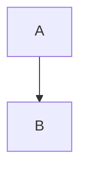

```python
def greet(name: str) -> str:
    """Docstring."""
    return f"Hello, {name}!"  # comment
```

```js
const x = [1, 2, 3].map((n) => n * 2);
```

```diff
- removed line
+ added line
```

```json
{"key": "value", "n": 1, "ok": true}
```

```
no language
	tab	indented
```

```nosuchlanguage
kept verbatim
```



```math
E = mc^2
```

~~~bash
echo "tilde fence"
~~~

A very long code line follows:

```text
this_is_a_very_long_identifier_that_will_not_fit_in_the_available_width_of_the_terminal_and_must_wrap
```

Inline `code with   spaces` and ``code with ` backtick``.
